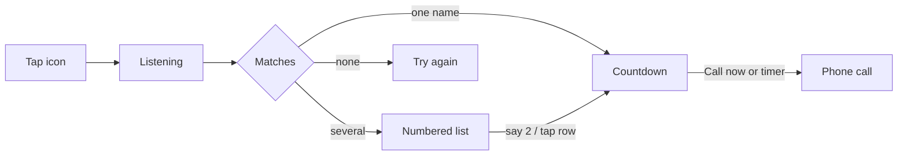

<h1 align="center">🎤 Voice Dial</h1>

<p align="center">
  <strong>Say a name. The car places the call.</strong><br/>
  Hands-free contact dialing for <em>Android Auto</em> and the phone — Hebrew and English.
</p>

<p align="center">
  <a href="#english">English</a> ·
  <a href="#עברית">עברית</a>
</p>

<p align="center">
  
  
  
  
</p>

<p align="center">
  
  
  
  
  
</p>

---

# English

Tap the icon on the car screen. Listening starts **immediately**. Say a contact — *«תתקשר לדנה»*, *«call Yosef»* — and Voice Dial matches your address book, ducks the music like Waze, and places the call.

No recents. No favorites. Name in, call out.

## How it feels



| What happens | What you do |
|---|---|
| App opens | Nothing — the mic is already live |
| One contact matches | 5s countdown. **Call now** or **Cancel** |
| Several contacts match | Numbered list, mic still open. Say *«two»* / *«שתיים»* or the name |
| Music is playing | It **ducks**, it does not pause — same idea as Waze guidance |
| You misspeak | **Start listening again**. No auto-restart after a no-match |

The duck stays down from the first listen, through the list and the countdown, until the phone call actually takes audio. There is no volume spike between screens.

## Highlights

<table>
<tr>
<td width="50%" valign="top">

**Car**
- Immediate listen on every icon tap
- Message + list templates only (driving-safe)
- RTL follows the **phone** locale
- Silent nav pad so Android Auto ducks like Waze
- Incoming call kills TTS + mic; no auto-resume

</td>
<td width="50%" valign="top">

**Recognition**
- Google `SpeechRecognizer` (he-IL / en-US)
- On-device **Silero VAD** — ends ~0.5s after you stop
- First-name lists (*«חני»* → every חני)
- Hebrew ↔ Latin phonetic matching
- Duplicate contacts merged by number

</td>
</tr>
<tr>
<td width="50%" valign="top">

**Phone**
- Same state machine as the car
- Material 3 / Material You
- Big mic FAB, live transcript, countdown card
- Gear → language, timings, VAD, diagnostics

</td>
<td width="50%" valign="top">

**Safety rails**
- Circuit breaker: max 3 auto-starts / 20s
- Car host step quota: listening text is a refresh, not a new step
- Hide flaps from Android Auto are ignored (~400ms)
- Full rolling log, phone numbers masked

</td>
</tr>
</table>

## Say this

| You say | Result |
|---|---|
| `תתקשר לדנה` / `call Dana` | Match *דנה* |
| `שתיים` / `two` / `number 3` / `השני` | Pick a list row |
| `ביטול` / `cancel` | Abort (whole utterance) |
| A first name with several people | Numbered list, mic already open |

## Install on a real car

Android Auto only shows Car App Library apps that look like they came from **Play**. A plain `adb install` is not enough.

1. Install the APK on the phone (same package as before — it updates in place).
2. Grant **microphone**, **contacts**, **phone**.
3. Install [Shizuku](https://github.com/RikkaApps/Shizuku) (or Shizuku-Next), start it via wireless debugging.
4. Voice Dial → ⚙️ → **Show in Android Auto** → **Reinstall as Play (Shizuku)**.
5. Status must be **green**. Force-stop Android Auto, replug the car.

Without Shizuku: copy the `adb` command from that settings screen (USB).

> **DHU** (Desktop Head Unit) shows sideloaded apps. A real head unit usually does not, until Play registration is green.
>
> Default category is **POI** (MessageTemplate + ListTemplate). `CALLING` is Play labs / internal-closed tracks only:
> `./gradlew assembleDebug -PcarCategory=androidx.car.app.category.CALLING`

### DHU

```bash
adb forward tcp:5277 tcp:5277
# phone: Android Auto → ⋮ → Start head unit server
cd "$ANDROID_HOME/extras/google/auto" && ./desktop-head-unit
```

Enable Android Auto developer settings: About → tap version 10 times.

## Build

| | |
|---|---|
| JDK | **17** |
| AGP / Gradle / Kotlin | 8.13.2 / 8.13 / 2.2.21 |
| compileSdk / targetSdk / minSdk | 36 / 36 / 26 |
| ABI | `arm64-v8a`, `armeabi-v7a` (no x86 emulator) |

```bash
./gradlew assembleDebug
./gradlew testDebugUnitTest
```

Change `applicationId` (`com.example.voicedialauto`) before any Play upload.

A normal APK update **resets Play registration**. Run *Reinstall as Play* again.

## Project map

```
app/src/main/java/com/example/voicedialauto/
├── flow/          DialController — one state machine, JVM-tested
├── car/           Android Auto session + templates
├── speech/        Recognizer, Silero VAD, NavDuck, TTS
├── contacts/      Cache, matcher, spoken numbers, echo filter
└── playreg/       Sideload-as-Play helper
```

Phone UI and car UI only **render** `DialState`. Behavior lives in `DialController`. Full UX contract: [`SPEC.md`](SPEC.md) (some list-TTS lines there are historical — the list is silent in v16).

## Limits (read this)

- Not a Play Production calling app. No Jetpack Telecom / in-app VoIP.
- Unknown sources does **not** apply to Car App Library on a real car.
- Built-in *Hey Google, call Dana* already exists. This app is for a dedicated, always-listen icon.
- Phonetic Hebrew↔Latin is coarse. Ambiguous hits become a list, they do not silently dial the wrong person.

## Credits

| | License |
|---|---|
| [Silero VAD](https://github.com/snakers4/silero-vad) v4 | MIT · `assets/silero_vad.onnx` |
| ONNX Runtime 1.22 | MIT |
| [android-vad](https://github.com/gkonovalov/android-vad) WebRTC | MIT / BSD |
| Shizuku | Apache-2.0 |

---

<div dir="rtl" lang="he">

# עברית

לוחצים על האייקון במסך הרכב. הזיהוי **מתחיל מיד**. אומרים שם — «תתקשר לדנה», «call Yosef» — האפליקציה מוצאת באנשי הקשר, מנמיכה מוזיקה כמו וייז, ומחייגת.

אין אחרונים. אין מועדפים. שם פנימה, שיחה החוצה.

## איך זה מרגיש

אותו תרשים כמו למעלה. בקצרה:

| מה קורה | מה עושים |
|---|---|
| האפליקציה נפתחת | כלום — המיקרופון כבר חי |
| התאמה אחת | ספירה 5 שנ׳. **חייג עכשיו** או **בטל התקשרות** |
| כמה התאמות | רשימה ממוספרת, מיקרופון פתוח. אומרים «שתיים» / «two» או את השם |
| יש מוזיקה | היא **יורדת**, לא נעצרת — כמו הנחיות וייז |
| פספוס | **התחל האזנה שוב**. אחרי «לא נמצא» אין הפעלה אוטומטית |

ההנמכה נשארת מרגע הזיהוי, דרך הרשימה והספירה, עד שהשיחה באמת תופסת אודיו. אין קפיצת ווליום בין מסכים.

## מה יש כאן

**רכב**
- זיהוי מיידי בכל לחיצה על האייקון
- רק תבניות הודעה ורשימה (מותר בנהיגה)
- כיוון המסך לפי שפת **הטלפון**
- פד ניווט שקט כדי שאנדרואיד אוטו ינמיך כמו וייז
- שיחה נכנסת עוצרת הקראה ומיקרופון, בלי חזרה אוטומטית

**זיהוי**
- `SpeechRecognizer` של גוגל (עברית / אנגלית)
- **Silero VAD** על המכשיר — נגמר בערך חצי שנייה אחרי ששותקים
- שם פרטי פותח רשימה של כולם («חני» > כל החניות)
- התאמה פונטית עברית <> לטינית
- כפילויות מתאחדות לפי מספר

**טלפון**
- אותה מכונת מצבים כמו ברכב
- Material 3 / Material You
- כפתור מיקרופון גדול, תמליל חי, כרטיס ספירה
- גלגל שיניים > שפה, זמנים, VAD, אבחון

**הגנות**
- לכל היותר 3 הפעלות אוטומטיות ב-20 שנ׳
- תקציב הצעדים של הרכב: טקסט הקשבה הוא רענון, לא צעד חדש
- סגירה-פתיחה מהירה של אנדרואיד אוטו (~400ms) לא הורגת מיקרופון
- לוג מתגלגל, מספרי טלפון מוסתרים

## מה אומרים

| אומרים | תוצאה |
|---|---|
| `תתקשר לדנה` / `call Dana` | מוצאים את דנה |
| `שתיים` / `two` / `מספר 3` / `השני` | בוחרים שורה ברשימה |
| `ביטול` / `cancel` | מבטלים (כל האמירה) |
| שם פרטי עם כמה אנשים | רשימה, המיקרופון כבר פתוח |

## התקנה ברכב אמיתי

אנדרואיד אוטו מציג אפליקציות Car App Library רק אם נראה שהן הגיעו מ-**Play**. `adb install` רגיל לא מספיק.

1. מתקינים את ה-APK בטלפון (אותה חבילה > מתעדכן במקום).
2. מאשרים **מיקרופון**, **אנשי קשר**, **טלפון**.
3. מתקינים [Shizuku](https://github.com/RikkaApps/Shizuku) (או Shizuku-Next), מפעילים דרך ניפוי באגים אלחוטי.
4. חיוג קולי > גלגל שיניים > **הצגה ב-Android Auto** > **התקן מחדש כ-Play (Shizuku)**.
5. הסטטוס חייב להיות **ירוק**. Force-stop ל-Android Auto, מנתקים וחוברים לרכב.

בלי Shizuku: מעתיקים את פקודת ה-`adb` מאותו מסך הגדרות (USB).

> **DHU** מציג אפליקציות שהותקנו ידנית. ראש יחידה אמיתי בדרך כלל לא, עד שהרישום כ-Play ירוק.
>
> קטגוריית ברירת מחדל: **POI**. `CALLING` רק במסלולי מעבדה/בדיקה סגורה של Play:
> `./gradlew assembleDebug -PcarCategory=androidx.car.app.category.CALLING`

### DHU

```bash
adb forward tcp:5277 tcp:5277
# בטלפון: Android Auto > ⋮ > Start head unit server
cd "$ANDROID_HOME/extras/google/auto" && ./desktop-head-unit
```

מצב מפתח ב-Android Auto: אודות > לחיצה 10 פעמים על הגרסה.

## בנייה

| | |
|---|---|
| JDK | **17** |
| AGP / Gradle / Kotlin | 8.13.2 / 8.13 / 2.2.21 |
| compileSdk / targetSdk / minSdk | 36 / 36 / 26 |
| ABI | `arm64-v8a`, `armeabi-v7a` (אין אמולטור x86) |

```bash
./gradlew assembleDebug
./gradlew testDebugUnitTest
```

לפני העלאה ל-Play מחליפים `applicationId` (`com.example.voicedialauto`).

עדכון APK רגיל **מאפס** את הרישום כ-Play. מריצים שוב *התקן מחדש כ-Play*.

## מבנה

```
app/src/main/java/com/example/voicedialauto/
├── flow/          DialController — מכונת מצבים אחת, עם בדיקות JVM
├── car/           סשן Android Auto ותבניות
├── speech/        מזהה, Silero VAD, NavDuck, TTS
├── contacts/      מטמון, התאמה, מספרים מדוברים, סינון הד
└── playreg/       עזר sideload-as-Play
```

הטלפון והרכב רק **מציירים** `DialState`. ההתנהגות ב-`DialController`. חוזה UX מלא: [`SPEC.md`](SPEC.md) (שורות על הקראת רשימה שם הן היסטוריות — ב-v16 הרשימה שקטה).

## מגבלות

- לא אפליקציית שיחות ל-Play Production. אין Jetpack Telecom / VoIP פנימי.
- «מקורות לא ידועים» **לא** חל על Car App Library ברכב אמיתי.
- *Hey Google, call Dana* כבר קיים במערכת. כאן האייקון תמיד מקשיב.
- ההתאמה הפונטית גסה. דו-משמעות הולכת לרשימה, לא מחייגת בשקט לאדם הלא נכון.

## קרדיטים

| | רישיון |
|---|---|
| [Silero VAD](https://github.com/snakers4/silero-vad) v4 | MIT · `assets/silero_vad.onnx` |
| ONNX Runtime 1.22 | MIT |
| [android-vad](https://github.com/gkonovalov/android-vad) WebRTC | MIT / BSD |
| Shizuku | Apache-2.0 |

</div>
